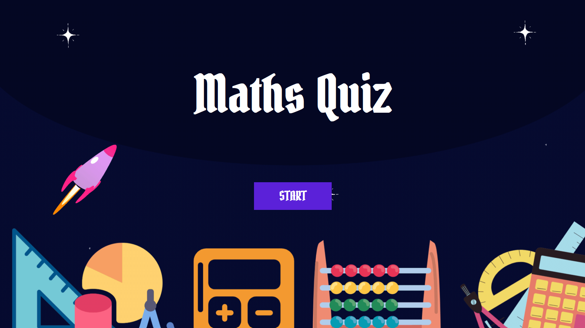
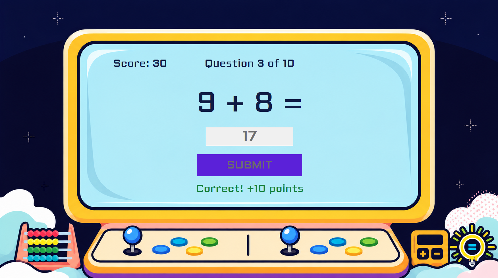
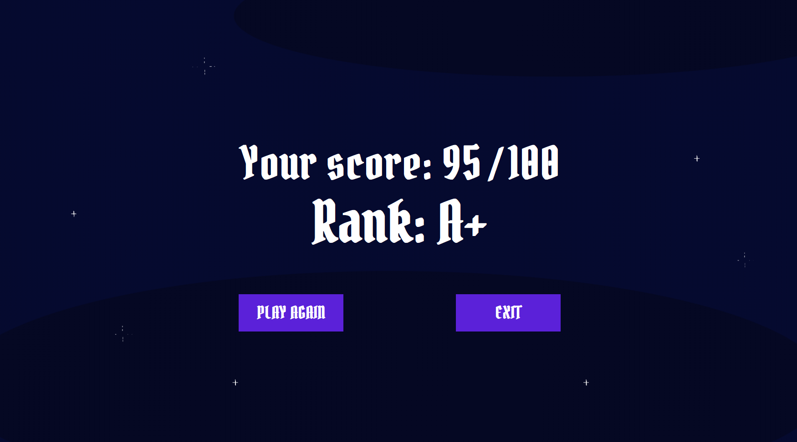

# Exercise 1 - Maths Quiz

A Tkinter quiz of 10 addition and subtraction questions with three difficulty levels.

## What it does
- **Screens:** title, instructions, difficulty menu, quiz, results.
- **Levels:** Easy (1 to 9), Moderate (10 to 99) and Advanced (1000 to 9999).
- **Scoring:** 10 points for a correct answer on the first try, 5 on the second, 0 if both are
  wrong. The correct answer is shown after a second wrong try.
- **Results:** the score out of 100, a rank (A+ to F), and options to play again or exit.
- **Look:** animated GIF backgrounds, a loading screen, a floating title, and two custom fonts.
- **Window:** it can be minimised, maximised and resized, and the picture scales to fit.

## How to run
```
pip install pillow
python maths_quiz.py
```
Keep the `assets` folder next to `maths_quiz.py`. It holds `bg_title.gif`, `bg_main.gif`,
`bg_quiz.png` and a `fonts` folder. Press Escape to close the program.

## How it works
- **`randomInt(level)`, `decideOperation()`, `getRank(score)`:** small functions with no window
  code, so they are easy to test.
- **`MathsQuiz` class:** keeps the score, question number and level together. There is one method
  for each screen (`displayTitle`, `displayInstructions`, `displayMenu`, `startQuiz`,
  `displayResults`) and methods for the quiz itself (`displayProblem`, `isCorrect`, `submitAnswer`).
- **Animations:** each screen gets a number (`screenNumber`). An animation remembers its screen's
  number and stops when the number changes, so old animations never run on a new screen.
- **Resizing:** `onResize` waits until the resizing stops, then `fitToWindow` reloads the
  pictures at the new size and redraws the screen. The quiz keeps the current question, score and
  typed answer.
- **Fonts:** if a font can't be loaded, the program uses Comic Sans MS instead (the font files are
  loaded on Windows only).

## Screenshots



