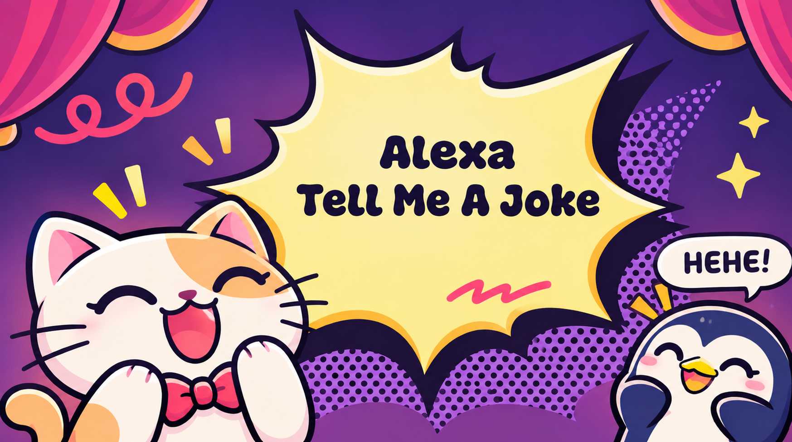
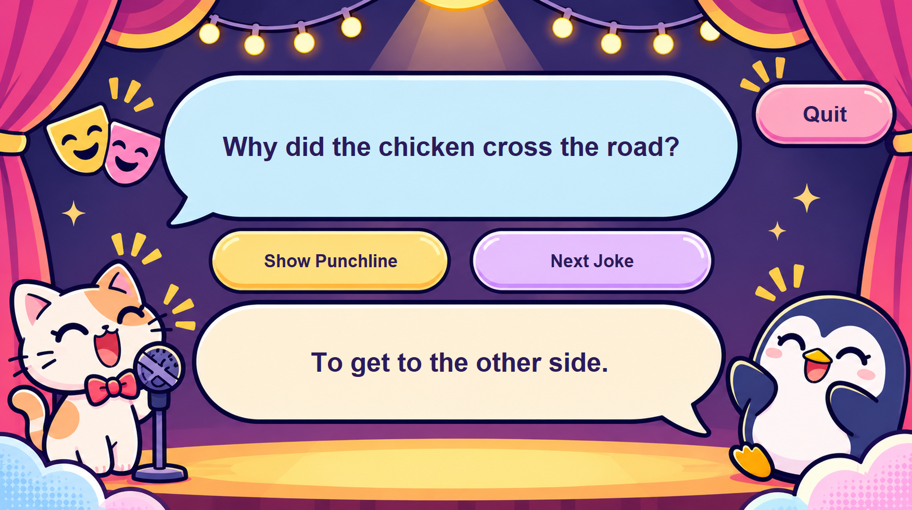
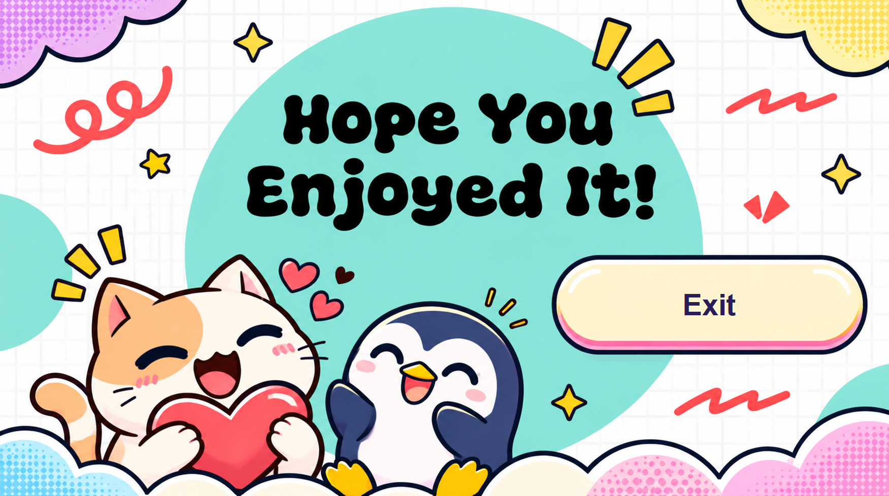

# Exercise 2 - Alexa, Tell Me a Joke

A Tkinter app that tells jokes from `randomJokes.txt`.

## What it does
- **Title screen:** click "Alexa Tell Me A Joke" to start.
- **Jokes screen:** shows the setup of a random joke. "Show Punchline" reveals the punchline and
  "Next Joke" tells another. Jokes come in a shuffled order, so none repeats until all have been told.
- **Sound:** each setup and punchline is read out, a laugh plays just before the punchline ends,
  and background music loops throughout.
- **End screen:** "Quit" goes to a goodbye screen with an "Exit" button.
- **Window:** it can be minimised, maximised and resized, and the picture scales to fit. F11 switches
  to full screen and Escape goes back.

## How to run
```
pip install pillow pygame
python alexa_jokes.py
```
Keep `randomJokes.txt` (or a `resources` folder holding it) near the program, and the `assets`
folder next to it. `assets` holds `bg_title.png`, `bg_jokes.png`, `bg_end.png` and an `audio` folder.

### Making the narration
The narration files in `assets/audio` were made by `make_audio.py`, which uses the free
`edge-tts` voices:
```
pip install edge-tts
python make_audio.py
```
This creates `joke_01_setup.mp3`, `joke_01_punchline.mp3`, and so on, in the order of the jokes in
`randomJokes.txt`. You only need to run it again if you change the jokes or the voice. If the audio
files are missing, the app still works, but silently.

## How it works
- **`find_jokes_file()` and `load_jokes()`:** look for the file and split each line at the first
  question mark into a setup and a punchline.
- **`JokeApp` class:** the invisible buttons are a list of rectangles, and `on_click` checks which one
  a click landed inside. Each screen has its own method (`show_title`, `show_jokes`, `show_end`).
- **Shuffled jokes:** `next_joke` takes jokes from a shuffled list (`unused_jokes`) and reshuffles
  when the list is empty.
- **Sound:** `pygame.mixer` plays the voices and the laugh, and `pygame.mixer.music` loops the
  background music. The laugh is scheduled with `after()` using the length of the punchline audio.

## Screenshots



