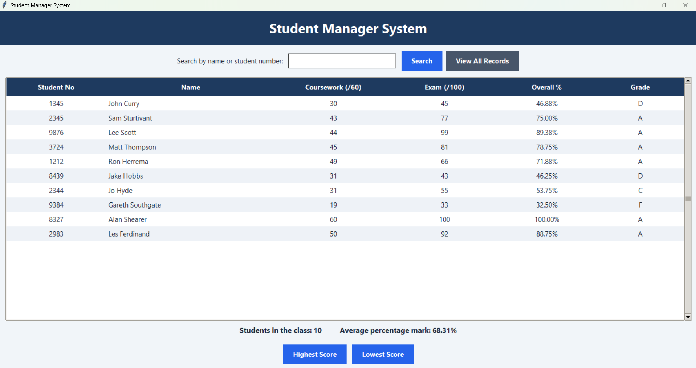
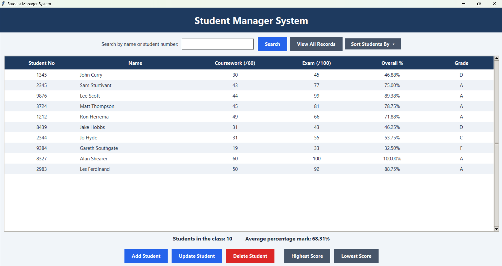

# Exercise 3 - Student Manager

A Tkinter app for managing the marks in `studentMarks.txt`. There are two versions.

| File | What it does |
|------|--------------|
| `student_manager.py` | The basic task: view all records, search for a student, show the highest and lowest total |
| `student_manager_extended.py` | The extension task: everything above plus sort, add, update and delete, with changes saved to the file |

## About the data
The first line of `studentMarks.txt` is the number of students. Each other line is:
```
8439,Jake Hobbs,10,11,10,43
```
which is the student number, name, three coursework marks (out of 20) and the exam mark (out of
100). The overall percentage is out of 160 marks. Grades: A is 70% and above, B 60-69%, C 50-59%,
D 40-49%, F below 40%.

## How to run
```
python student_manager.py
python student_manager_extended.py
```
No extra libraries are needed. The program looks for `studentMarks.txt` next to itself, in a
`resources` folder next to it, and in the folder above it (also in a `resources` folder there).

**Important:** the extension rewrites `studentMarks.txt` when you add, update or delete a student.
Keep a copy of the original file if you want to restore it.

## What it does
- **View all records:** every student with their coursework total, exam mark, percentage and grade,
  plus the class size and the average percentage.
- **Search:** by student number or by (part of) a name.
- **Highest and lowest score:** shows the student or students with the top or bottom total.
- **Sort (extension):** by name, student number, coursework, exam mark or overall percentage, in
  ascending or descending order.
- **Add, update and delete (extension):** a form on the right with checks on every box. Delete asks
  for confirmation.

## How it works
- **`Student` class:** holds one record and works out `coursework_total()`, `total()`,
  `percentage()` and `grade()`.
- **`load_students()` and `save_students()`:** read the file into `Student` objects, and write the
  whole list back in the same format.
- **`read_form()`:** checks every box in the Add and Update form and returns a student or an error
  message, using the small `read_number()` function.
- **Table:** each row uses the student number as its id, so the program can find the student that
  is selected.

## Screenshots


